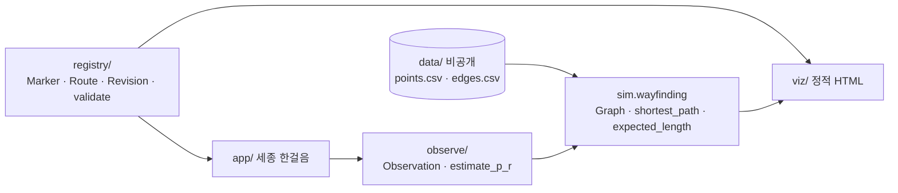

# Design — 세종청사 5·6동 Wayfinding 시범

## 개요
상세 근거는 저장소 `README.md` (4·5·6·7·8·9장). 이 문서는 구현 관점의 설계만 담는다.

## 아키텍처

## 컴포넌트

### sim.wayfinding (구현됨)
- `Graph(nodes: dict[str, (x, y)], edges: tuple[(a, b)])` — 무방향, 가중치 = 유클리드 px.
- `shortest_path(g, src, dst) -> (length, path)` — 이진 힙 Dijkstra. 경로 없으면 `ValueError`.
- `expected_length(l0, p, r, d) -> float` — `l0 + 2*p*r*d`, p·r 범위 검증.
- `extra_length_table(ps, rs, d) -> {(p, r): px}` — README 7.4 표.
- 상수: `PLANNED_ROUTES_PX`, `B_R5_L0_PX = 303.46`, `B_J_MISENTRY_BRANCH_PX = 30.02`.

### data loader (예정)
- `data/points.csv`: `id,x,y,kind` (kind ∈ origin|junction|reception|waypoint)
- `data/edges.csv`: `a,b`
- `sim.io.load_graph(dir) -> Graph`. 파일이 없으면 테스트는 skip.

### registry (예정)
- dataclass: `Marker`, `Route`, `Revision`. JSON 파일 저장 (`registry/registry.json`), DB 없음.
- `validate(registry) -> list[Issue]`
  - Route 의 Marker 가 같은 Revision 인지
  - 같은 `building_no`+`purpose` 의 표기 문자열 일치
  - 금지 노드(kind = staff_only | internal) 포함 여부
- 승인은 사람이 한다. 코드는 검증만.

### observe (예정)
- `Observation` dataclass (Requirement 4.1 필드, 개인정보 없음).
- `estimate_p(obs, junction)`, `estimate_r(obs, junction, branch_len)`.
- 조건(N0/N1/N2)·분기별 집계 + n 표시. 표본 n < 10 이면 "표본 부족" 표시.

### viz (예정)
- 단일 `viz/index.html` + 인라인 JS. 입력은 `sim` 이 만든 `routes.json` (합성 좌표 가능).
- 정상 경로, 오진입 가지(r 비율만큼), 복귀를 애니메이션.

### app (후속 승인 후)
- 정적 Mobile Web App. URL `?m=<marker_code>` 로 진입.
- 상태: 출발확인 → 단계안내 ⇄ 도움 → 도착확인 → 의견.
- 저장: 의견은 익명 세션 해시만. 위치는 마지막 Marker code 만.

## 오류 처리
- 계산: 범위 밖 p·r, 경로 없음 → 예외.
- 대장: 검증 오류는 목록으로 모두 반환(첫 오류에서 멈추지 않음).

## 테스트 전략
- 원자료 수치 재현 테스트(표 7.4, 363.5px)는 회귀 기준선.
- 실제 좌표 테스트는 `data/` 존재 시에만 실행.
- 대장 검증은 합성 대장으로 각 규칙의 위반 사례를 하나씩.
