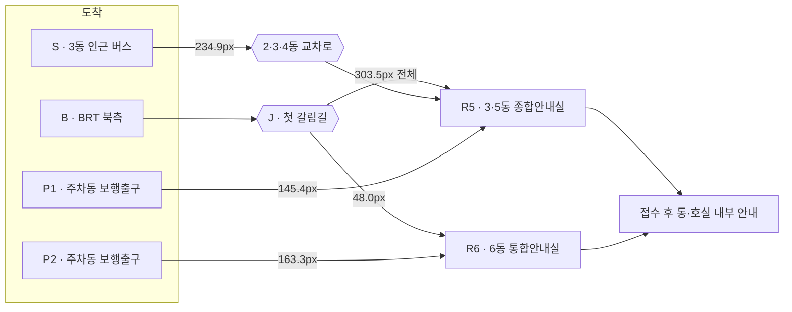
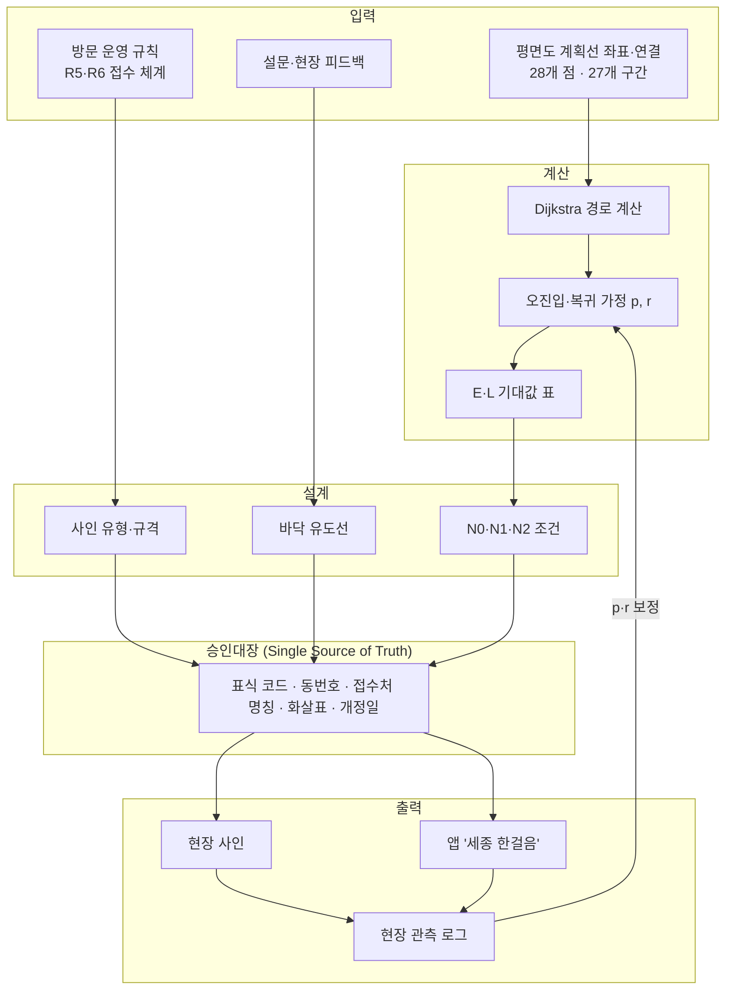
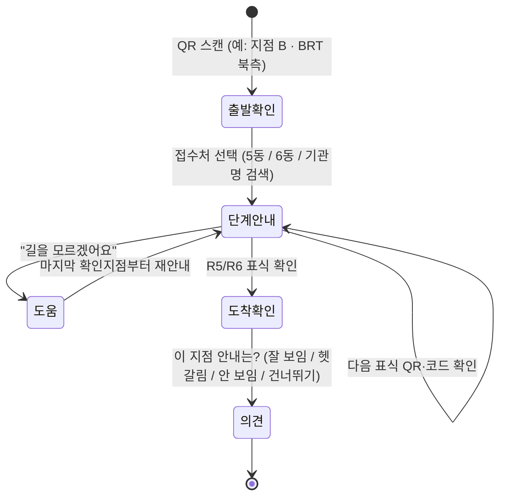

# 건축물 안전관리 플랫폼 · 정부세종청사 방문자 동선(Wayfinding) 시범

> **결론 먼저.** 이 저장소는 건축물 안전관리 플랫폼의 첫 번째 모듈입니다.
> 첫 모듈은 정부세종청사 **5·6동 방문자 동선** 시범입니다.
> 방문자가 BRT·버스·주차장에서 내려 **방문접수처(R5·R6)** 까지 덜 헤매게 만드는 것이 목표입니다.
> 길을 새로 내지 않습니다. **안내를 찾고, 고르고, 확인하는 순서**를 바꿉니다.
> 현재 단계는 "계획선 기반 계산 + 넛지 설계"입니다. **현장 행동 효과는 아직 측정 전**입니다.

| 항목 | 내용 |
|---|---|
| 문서 종류 | 설계 문서 겸 기술 보고서 (Design Document / Technical Report) |
| 기준일 | 2026-11-06 |
| 원자료 | ① `2026.11.04_세종정부청사 안내사인물 동선계획(5,6동 시범).pptx` (14장) ② `AI 방문자 동선 시뮬레이션 (넛지 이론 적용).pptx` (15장) — 출처: Notion `atom_followup (20261105)` |
| 원자료 보관 | 로컬 `docs/source/` (외부 협의 자료라 Git 에 올리지 않음, `.gitignore`) |
| 개발 도구 | [Kiro](https://kiro.dev) spec 기반 개발 — `.kiro/steering`, `.kiro/specs` |
| 상태 | 설계·계산 검산 완료 / 현장 실증·앱 개발은 후속 사업 (별도 승인·예산) |

---

## 목차

1. [배경 — 왜 이 문서가 있나](#1-배경--왜-이-문서가-있나)
2. [용어 정리](#2-용어-정리)
3. [문제 정의 — 방문자는 어디서 헤매나](#3-문제-정의--방문자는-어디서-헤매나)
4. [플랫폼 전체 구조](#4-플랫폼-전체-구조)
5. [모듈 1 설계 — 안내사인 체계](#5-모듈-1-설계--안내사인-체계)
6. [모듈 1 설계 — 넛지(Nudge) 적용 원리](#6-모듈-1-설계--넛지nudge-적용-원리)
7. [시뮬레이션 모형 — 경로 계산과 오진입 기대값](#7-시뮬레이션-모형--경로-계산과-오진입-기대값)
8. [검증 계획 — N0·N1·N2 비교](#8-검증-계획--n0n1n2-비교)
9. [앱 서비스 구상 — '세종 한걸음'](#9-앱-서비스-구상--세종-한걸음)
10. [개선 대안 비교와 권장 조합](#10-개선-대안-비교와-권장-조합)
11. [운영·보안·개인정보·접근성](#11-운영보안개인정보접근성)
12. [한계와 주의사항](#12-한계와-주의사항)
13. [로드맵](#13-로드맵)
14. [저장소 구조와 실행 방법](#14-저장소-구조와-실행-방법)
15. [Kiro 로 개발하기](#15-kiro-로-개발하기)
16. [참고 문헌](#16-참고-문헌)

---

## 1. 배경 — 왜 이 문서가 있나

### 1.1 누가, 무엇을 하나

- **(주)에이톰엔지니어링(ATOM ENGINEERING)** 은 건축물 안전진단·안전점검·구조설계를 하는 회사입니다.
- 회사 홈페이지 기준으로 국토교통부 지정 안전진단전문기관이고, 드론 점검·AI 균열 모니터링(A-Monitor)·3D 기반 시설물 안전관리 특허를 가지고 있습니다.
- 이 회사가 하는 일은 지금까지 **건물의 몸(구조)** 을 지키는 일이었습니다.
- 이 저장소는 그 범위를 **건물을 쓰는 사람(이용자)** 까지 넓히려는 시도입니다.

### 1.2 왜 "건축물 안전관리"에 "동선"이 들어가나

- 건물 관리는 구조 점검만으로 끝나지 않습니다.
- 사람이 건물 안팎을 **어떻게 움직이는지**도 관리 대상입니다.
- 길을 잃은 방문자는 차도를 건너고, 직원 전용 출입구로 들어가고, 엉뚱한 접수처에 줄을 섭니다.
- 이것은 불편이면서 동시에 **보행 안전·보안·운영 효율** 문제입니다.
- 그래서 플랫폼은 "구조 안전 + 이용자 동선"을 한 곳에서 관리하는 것을 목표로 합니다.

### 1.3 왜 정부세종청사 5·6동인가

- 정부세종청사는 1–17동과 중앙동으로 이루어진 큰 단지입니다.
- 방문 운영이 동마다 다릅니다.
  - **6동**: 종합안내동에서 통합 접수 → 1차 목적지는 **R6 (6동 통합안내실)**
  - **3·5동**: 공용 방문입구 안내 → 1차 목적지는 **R5 (3·5동 종합안내실)**
- 2026-10-30 현장 피드백과 방문자·직원 설문이 이미 있습니다.
- 그래서 5·6동을 **시범구역**으로 정하고, 효과가 확인된 규칙만 전 청사로 넓힙니다.

### 1.4 전제

1. 경로(길) 자체는 바꾸지 않습니다. 안내 정보의 **구성과 위치**만 바꿉니다.
2. 도상 길이(px)는 평면도 위 길이입니다. **미터(m)도, 초(s)도 아닙니다.**
3. 오진입 비율 `p`, 오류 발견 비율 `r` 은 **가정값**입니다. 넛지 효과 예측이 아닙니다.
4. 방문자 주차는 공식 방문·차량 등록 절차를 따릅니다.
5. 연결 지붕이나 **직원 전용 출입구는 방문자 지름길로 표시하지 않습니다.**
6. 안전표지(대피 등)는 별도 표준 체계를 그대로 유지합니다.

---

## 2. 용어 정리

| 용어 | 쉬운 뜻 | 어떻게 읽나 |
|---|---|---|
| Wayfinding | 처음 온 사람이 스스로 길을 찾도록 돕는 안내 체계 | 웨이파인딩 |
| Nudge | 강요하지 않고, 더 좋은 선택을 쉽게 하도록 슬쩍 돕는 설계 | 넛지 |
| EAST | 넛지 설계 4원칙: Easy(쉽게)·Attractive(눈에 띄게)·Social(사회적)·Timely(제때). 이 과제는 Social 을 뺌 | 이스트 |
| BASIC | OECD 의 행동과학 적용 절차 (Behaviour·Analysis·Strategies·Intervention·Change) | 베이직 |
| BRT | 버스 전용 도로를 달리는 급행 버스 | 비알티 |
| R5 / R6 | 방문접수처. R5 = 3·5동 종합안내실, R6 = 6동 통합안내실 | 알오 / 알육 |
| B / S / P1 / P2 | 출발점. B = BRT 북측, S = 3동 인근 버스정류장, P1·P2 = 주차동 보행 출구 | 비 / 에스 / 피원 / 피투 |
| J | BRT 에서 내려 처음 만나는 갈림길 (Junction) | 제이 |
| 도상길이 (px) | 평면도 그림 위에서 잰 길이. 실제 거리 아님 | 도상 픽셀 |
| Dijkstra | 그래프에서 가장 짧은 길을 찾는 알고리즘 | 다익스트라 |
| 오진입 (Misentry) | 갈림길에서 틀린 쪽으로 들어가는 것 | 오진입 |
| `p` | 갈림길에서 틀린 쪽을 고르는 비율 | 피 |
| `r` | 틀린 길을 얼마나 갔을 때 알아차리는지 (가지 길이 대비 비율, 0–1) | 알 |
| `d` | 틀린 가지(branch)의 길이 | 디 |
| `E[L]` | 평균적으로 걷게 되는 도상길이 (기댓값, Expected Length) | 이 엘 |
| N0 / N1 / N2 | 안내 조건. N0 = 현황, N1 = 분기 전 선택 지원, N2 = N1 + 이동 중 확인 | 엔제로 / 엔원 / 엔투 |
| ALT | 경로 대안 (길 자체를 바꾸는 안). N 조건과 다름 | 알트 |
| QR | 휴대폰 카메라로 찍는 사각형 코드 | 큐알 |
| Mobile Web App | 설치 없이 브라우저로 여는 앱 | 모바일 웹앱 |
| Steering (Kiro) | Kiro 에게 "이 프로젝트는 이런 규칙"이라고 알려주는 상시 문서 | 스티어링 |
| Spec (Kiro) | 요구사항 → 설계 → 작업 목록 3단 문서. Kiro 가 이것을 보고 구현 | 스펙 |
| EARS | 요구사항을 "WHEN … THE SYSTEM SHALL …" 형태로 쓰는 표기법 | 이어스 |

---

## 3. 문제 정의 — 방문자는 어디서 헤매나

### 3.1 근거 자료 요약

| 근거 | 현황·요구 | 설계에 반영할 내용 |
|---|---|---|
| 운영 | 6동은 종합안내동에서 통합 접수, 3·5동은 공용 방문입구 안내 | 5동은 R5, 6동은 R6 를 1차 목적지로 표기 → 접수 후 해당 동·호실로 이동 |
| 설문 | 방문자 **29/44명(65.9%)** 바닥 유도 필요, **30/44명(68.2%)** 정문 방향안내 추가 선택 | 도착점에서 색선 시작, 분기점마다 동번호·화살표 반복 |
| 현장 | 전체지도·지주·이동식 표지가 섞여 있음. 교차로에서 다음 방향을 스스로 판단해야 함 | 전체지도 + 5·6동 상세도, 고정 방향판, 차량표지와 보행표지 분리 |

> 그래서 무슨 뜻? 방문자 3명 중 2명이 "바닥에 선이 있었으면 좋겠다"고 답했습니다.
> 다만 **선호 의견이 곧 길찾기 성공은 아닙니다.** 실제 행동은 따로 관찰해야 합니다 (8장).

### 3.2 도착 수단별 판단 지점



| 도착 | 이동 순서 | 지금 생기는 판단 문제 | 배치할 안내 |
|---|---|---|---|
| BRT | 북측 정류장 출구 → 횡단·보행로 → R6 또는 R5 | 큰 건물은 보이지만 **어느 접수처인지** 모름 | 출구: 전체 + 상세지도 / 분기: 5·6동 큰 숫자 |
| BUS | 3동 인근 정류장 → 2·3·4동 교차로 → R5 | 기관명 지주와 "방문입구 300m" 안내가 **따로 떨어져** 있음 | 정류장 앞 접수처 지도, 울타리 방향판 + 바닥선 |
| CAR | 방문자 주차 → 주차장 보행 출구 → R5 또는 R6 | 주차 유도 화살표만 있어 **하차 후** 길찾기가 안 됨 | 보행 출구에 접수처 안내, 차량 입구와 구별 표시 |

### 3.3 경로 선정 기준

1. 방문 가능한 입구로 연결한다.
2. 불필요한 도로 횡단을 최소화한다.
3. 분기점마다 안내가 끊기지 않게 한다.
4. "최적"은 최단거리가 아니라 **접수 동선과 보행 연속성** 기준이다.

---

## 4. 플랫폼 전체 구조

### 4.1 모듈 구성

플랫폼은 "건물"과 "사람" 두 축을 하나의 자산 대장(Asset Registry)으로 묶습니다.

| 모듈 | 대상 | 상태 | 비고 |
|---|---|---|---|
| **M1. Wayfinding** | 방문자 동선·안내사인·넛지 | **이 저장소에서 진행** | 세종청사 5·6동 시범 |
| M2. Inspection | 건축물관리법 정기·긴급점검 일정·이력 | 계획 | 제13·14조, 사용승인 후 5년 내 첫 점검 → 3년마다 |
| M3. Crack Monitoring | 원격 균열 모니터링 (A-Monitor 계열) | 계획 | 기존 사내 기술 연계 |
| M4. Digital Twin | 3D 기반 시설물 안전관리 시각화 | 계획 | 사인·점검·균열을 같은 좌표계에 |

> M2–M4 는 에이톰엔지니어링 홈페이지에 공개된 사업·특허를 바탕으로 한 **확장 방향**입니다. 이 저장소의 현재 범위는 M1 입니다.

### 4.2 M1 데이터 흐름



**핵심 불변식(Invariant):** 현장 사인 = 앱의 위치 확인점 = 의견 수집 지점.
세 가지는 **같은 승인대장의 같은 버전**에서 나옵니다. 하나만 바뀌는 일은 없습니다.

### 4.3 역할 분리

| 주체 | 하는 일 | 하지 않는 일 |
|---|---|---|
| AI (LLM) | 의견 분류·정리, 문안 초안 | 경로 계산, 승인 |
| 알고리즘 | Dijkstra 경로, 기대값 계산 | 행동 예측, 혼잡 시뮬레이션 |
| 담당자 | 현장·보안 확인, 검증, 승인 | — |

---

## 5. 모듈 1 설계 — 안내사인 체계

### 5.1 표기 원칙

- **색상 = 도착 수단** (BRT·BUS·CAR 각 1색)
- **숫자 = 목적 동** (5, 6)
- 크기 순서: **동번호 > 목적(방문접수) > 보조 영문(Visitor Reception)**
- 색상은 "단서"이고, 숫자·문자가 "필수 정보"입니다. 색각 차이가 있어도 동번호로 판단할 수 있어야 합니다.

### 5.2 사인 유형과 제안 규격

| 유형 | 역할 | 구성 | 규격 | 구분 |
|---|---|---|---|---|
| 도착점 안내 | "지금 어디, 어디로" | 전 청사 위치도 + 5·6동 확대도 | 1,500 × 2,550 mm | 기존 구조체 재활용 (현장 기록 규격) |
| 분기점 방향 | "여기서 어느 쪽" | 큰 동번호 + 목적 + 방향 | 600 × 2,200 mm | 신규 지주 **제안값** |
| 울타리 모듈 | 보행 눈높이 연속 안내 | 고정 볼트·클램프 + 교체형 면판 | 900 × 300 mm | 신규 **제안값** |
| 접수처 도착 | "맞게 왔다" | 큰 동번호 + 방문접수 + 영문 | — | 기존 조명과 연계 |

### 5.3 바닥 유도선

| 항목 | 제안 |
|---|---|
| 구성 | 색선 3개 병렬 (BRT·BUS·CAR) + 목적 동번호 |
| 선폭 | 100 mm |
| 동번호·화살표 | 200 mm 급 |
| 반복 규칙 | 갈림길 **전·후** 모두 표시, 다음 표식이 보이는 연속 구간 |
| 유지 | 점자블록·횡단보도 표시는 그대로 유지 |
| 관리 | 퇴색 구간은 구간별 재도장, 젖은 바닥 미끄럼 억제 |

### 5.4 정보 위계와 유지관리

- 동번호·"방문접수"는 **고정**, 기관명은 **교체형 패널**.
- 지도·지주·바닥표식의 목적지 명칭을 **같은 문자열**로 관리합니다.
- 면판 하단에 **관리번호와 개정일**을 작게 표기합니다.
- 야간: 동번호·화살표에 반사시트 적용.

**언어 배치 선호 (설문 Q2-6)**

| 선호 | 방문자 n=44 | 직원 n=75 |
|---|---|---|
| 한국어 우선 | 28 (63.6%) | 66 (88.0%) |
| 동일 비중 | 14 (31.8%) | 8 (10.7%) |
| 영어 우선 / 기타 | 2 (4.5%) / 0 | 0 / 1 (1.3%) |

> 그래서 무슨 뜻? 한국어 우선 + 영문 보조가 기본입니다. 다만 방문자의 1/3은 동일 비중을 원하므로, 외국인 방문이 많은 지점은 따로 검토합니다.

### 5.5 시범구역 적용 항목

| 지점 | 구체적 조치 | 방문자가 얻는 정보 |
|---|---|---|
| BRT 북측 출구 B | 종합안내도 면판 교체 / 파란 바닥선 시작 | 현재 위치, 5동 R5·6동 R6 방향 |
| 3동 인근 버스 S | 현재지도 확대 / 고정 방문접수 방향판 | 3·5동 방문입구와 300m 안내 |
| 주차동 P1·P2 | 보행 출구 표식 / 주황 바닥선 시작 | 주차 후 갈 접수처 |
| 2·3·4동 교차로 | 울타리 방향판 / 횡단 뒤 확인 표식 | 돌기 전에 방향, 지난 뒤 맞는지 확인 |
| R5·R6 접수처 | 큰 동번호·방문접수 표기 / 내부 안내 연계 | 맞는 접수처 도착과 이후 이동 |

**우선 적용 순서:** ① 기존 지도·방향판의 목적지 명칭 통일 → ② 도착점·갈림길 결손 보완 → ③ 바닥선으로 연결.

### 5.6 이동 단계별 안내요소 (Inbound → Inter → Outbound)

| 단계 | 안내요소 | 세종 적용 |
|---|---|---|
| Inbound 진입 | BRT 출구 | 현재 위치와 5·6동 방문접수 방향 |
| Inbound | 버스정류장 | 3동 인근 정류장에서 3·5동 접수처 연결 |
| Inbound | 주차 보행 출구 | 주차 유도와 하차 후 보행 안내 분리 |
| Inbound | 방문입구 표지 | 기존 300m 이동식 안내를 고정 방향판으로 보완 |
| Inter 이동 | 종합안내도 | 전 청사 위치도와 5·6동 확대도 병치 |
| Inter | 교차로 방향판 | 분기 전 방향표지 + 횡단 후 확인표식 |
| Inter | 바닥 유도선 | 세 가지 색선에 동번호·화살표 반복 |
| Inter | 동별 안내 | 접수 후 5·6동 해당 동·호실 안내 |
| Inter | 변경 정보 | 기관명은 면판 단위 교체, 명칭 동일 유지 |
| Outbound 귀가 | 퇴청 안내 | 방문증 반납 위치 표시 |
| Outbound | 귀가 방향판 | 출구에서 BRT·버스·주차장 방향 |
| Outbound | 대피·안전 | 별도 표준체계 유지 (이 과제 범위 밖) |

---

## 6. 모듈 1 설계 — 넛지(Nudge) 적용 원리

### 6.1 바꾸는 4가지 순간


### 6.2 원리 → 적용 → 측정

| 인지·행동 원리 | 방문자가 겪는 부담 | 5·6동 적용 | 확인할 변화 |
|---|---|---|---|
| 주의 환기 (Attractive) | 안내를 놓침 | 큰 5·6 숫자 + 방문접수 강조 | 표지 발견·식별 |
| 선택 단순화 (Easy) | 기관명·출입구를 동시에 판단 | 동번호 → 방문접수 → 방향 순서 | 첫 선택 오류 |
| 적시 안내 (Timely) | 갈림길 도착 후 멈춤 | 갈림길 **들어서기 전** 방향 예고 | 판단 정지시간 |
| 확인 피드백 (Wayfinding) | "맞는 길인가?" 계속 의심 | 전환 직후 번호 반복·도착 확인 | 역행·문의·오류 회복 |

- EAST 중 **E·A·T 만** 씁니다. **Social(남들도 이렇게 해요)은 뺍니다.**
- "대부분 이 길을 이용합니다" 같은 **근거 없는 군중 문구는 쓰지 않습니다.**
- "확인" 단계는 넛지 이론이 아니라 길찾기 연구(Brunyé 외, 2018)로 보완합니다.

> 한 줄로: **잘못 선택하지 않게 + 잘못 갔을 때 빨리 알아차리게.**

---

## 7. 시뮬레이션 모형 — 경로 계산과 오진입 기대값

### 7.1 무엇을 계산하나 / 무엇을 계산하지 않나

| 계산함 | 계산하지 않음 |
|---|---|
| 계획선 위 최단 도상길이 (Dijkstra) | 실제 보행 거리(m)·시간(s) |
| 가정 `p`, `r` 에 따른 평균 추가 도상길이 | 넛지 개선률 예측 |
| 경로 재생 (시각화) | 학습형 행동 예측, 군중·혼잡 시뮬레이션 |

### 7.2 입력: 계획 동선

28개 도상점, 27개 연결구간. 5개 대표 계획동선의 도상길이는 다음과 같습니다.

| 계획동선 | 도상길이 (px) |
|---|---|
| B → R6 | 48.0 |
| B → R5 | 303.5 |
| S → R5 | 234.9 |
| P1 → R5 | 145.4 |
| P2 → R6 | 163.3 |

> 주의: 현장 표지의 "300m" 와 도상 계산 234.9px 는 **서로 다른 단위의 다른 값**입니다. 비교하지 않습니다.

### 7.3 단일 오진입 모형

BRT 에서 R5 로 가는 방문자가 첫 갈림길 J 에서 R6 쪽으로 잘못 들어갔다가, 같은 길로 돌아오는 경우입니다.

```
        d (= 30.02px, 틀린 가지)
   J ───────────▶ (R6 방향)
   ▲   ◀─────────  r·d 만큼 갔다가 복귀
   │
   B ─────────────────────────▶ R5   (정상 L₀ = 303.46px)
```

$$
E[L] = L_0 + 2 \cdot p \cdot r \cdot d
$$

- 왕복이라 `2` 를 곱합니다. 틀린 가지를 끝까지(`r = 1`) 갔다 오면 추가량은 `2 × 30.02 = 60.04 ≈ 60.0px` 입니다.
- 그래서 정상 303.5px → 오진입 후 복귀 363.5px.

### 7.4 결과: 평균 추가 도상길이 (px)

정상 길이보다 **평균적으로 더 걷는 도상길이**입니다. `sim/wayfinding.py` 로 재계산했고, 원자료 표와 일치합니다 (`tests/test_wayfinding.py`).

| 오진입 비율 `p` | `r` = 0.25 (1/4 지점에서 알아챔) | `r` = 0.50 (절반) | `r` = 1.00 (R6 도착 후) |
|---|---|---|---|
| 10% 가정 | 1.5 | 3.0 | 6.0 |
| 20% 가정 | 3.0 | 6.0 | 12.0 |
| 30% 가정 | 4.5 | 9.0 | 18.0 |

**읽는 법.** `p = 20%` 에서 끝까지 가서 알아채면 평균 12.0px 더 걷습니다. 절반 지점에서 알아채면 6.0px 로 **절반**이 됩니다.

**두 가지 다른 레버(lever).**

| 레버 | 바꾸는 변수 | 담당 안내 조건 | 효과 모양 |
|---|---|---|---|
| 오진입을 줄인다 | `p` ↓ | **N1** (분기 전 선택 지원) | 표의 **행**을 위로 |
| 빨리 알아채게 한다 | `r` ↓ | **N2** (이동 중 확인) | 표의 **열**을 왼쪽으로 |

> 위 차이는 **가정 입력의 결과**입니다. N1·N2 의 실제 성과나 예상 개선률이 아닙니다.

### 7.5 알고리즘 메모

- 그래프: 무방향, 간선 가중치 = 두 점 사이 유클리드 거리(px).
- 탐색: 이진 힙 Dijkstra, `O((V + E) log V)`. V = 28, E = 27 이라 계산 비용은 무시할 수준.
- 27개 구간 / 28개 점 = 트리 구조(사이클 없음) → 두 점 사이 경로는 **유일**합니다. Dijkstra 는 이후 ALT(경로 대안) 간선이 추가될 때를 위한 것입니다.
- 계획선 좌표 원본은 원자료에만 있고 아직 이 저장소에 없습니다 → [로드맵](#13-로드맵) T-2.

---

## 8. 검증 계획 — N0·N1·N2 비교

### 8.1 조건 정의

**같은 보행경로**에서 **안내 정보 구성만** 바꾸는 시험안입니다. 경로 대안(ALT)과 섞지 않습니다.

| 조건 | 내용 | 기대하는 레버 |
|---|---|---|
| N0 현황 기준 | 현장 안내 상태를 사진·명칭·위치로 기록 | 기준선 (baseline) |
| N1 분기 전 선택 지원 | 큰 숫자 · 접수처 우선 · 갈림길 전 방향 예고 | `p` ↓ |
| N2 이동 중 확인 추가 | N1 + 번호·화살표 반복, 전환 후 확인, 접수 도착 표시 | `p` ↓ + `r` ↓ |

> **"N2 가 더 좋다"는 결론은 아직 없습니다.** 같은 조건에서 실제 행동 차이로 판단합니다.

### 8.2 관측 지표

| 관측 항목 | 기록 방법 | 판단 목적 |
|---|---|---|
| 첫 분기 오진입률 | 오진입 선택 건수 ÷ 해당 분기 선택 건수 | N1 의 선택 지원 여부 → `p` |
| 판단 정지시간 | 방향 판단을 위해 멈춘 시간만 | 정보처리 부담 |
| 오류 발견 위치 | 잘못 간 구간과 되돌아온 지점 | N2 의 조기 회복 여부 → `r` = 발견 거리 ÷ 가지 길이 |
| 문의·오접수 없는 도달 | 문의 횟수 / 올바른 접수처 첫 도달 | 전체 이용성 |

### 8.3 실험 설계 원칙

| 원칙 | 내용 |
|---|---|
| 조건 일치 | 같은 출발점·목적지, 시간대·가림·통행조건 기록 |
| 공정한 비교 | 초행 방문자 중심 배정, 반복 학습·군중 영향 통제, 출발·목적지·시간대 균형 배정 |
| 안전한 관찰 | 승인된 구역, 기존 안전표지 유지, 익명 기록, 보안 준수, 관찰 중 개입 최소화(안전 우선) |
| 참여 범위 | BRT·버스·주차 / 초행·재방문 / 고령·장애·외국어·디지털 비숙련 |
| 표본 | 질적 면담 4–8명/회 반복(안). 정량 효과 표본은 별도 산정 |
| 판정 금지 | 앱 접속·완료 로그만으로 성공 판정하지 않음. 중도 포기·비앱 이용자 포함 |

### 8.4 피드백 루프


---

## 9. 앱 서비스 구상 — '세종 한걸음'

> **후속 개발 제안**입니다. 실제 개발·배포 전이며, 현재 과업 범위(동선분석·검토의견)에 포함되지 않습니다.

### 9.1 원칙

- **설치·회원가입 없이** QR 로 여는 Mobile Web App.
- **상시 GPS·자동 이탈감지 없이** 시작합니다. 위치는 QR·수동 코드로만 갱신.
- **한 번에 한 단계**: 현재 표식과 다음 표식을 같은 동번호로 연결.
- **비앱 고정사인은 그대로 유지**합니다. 앱은 보조입니다.
- 큰 글씨·문자·음성 안내를 검토합니다.

### 9.2 화면 흐름



### 9.3 최소 데이터 모델 (제안)

| 엔티티 | 주요 필드 | 비고 |
|---|---|---|
| `Marker` (표식) | `code`, `building_no`, `purpose`, `arrow`, `lat_lng?`, `plan_xy`, `revision`, `status` | 승인대장의 한 줄. 현장 사인과 1:1 |
| `Route` | `origin`, `destination`, `marker_seq[]`, `revision`, `active` | 승인된 경로만, 중지 가능 |
| `Feedback` | `marker_code`, `rating`, `free_text?`, `ts`, `session_hash` | 개인 식별정보 없음 |
| `Revision` | `id`, `approved_by`, `approved_at`, `diff` | 사인·앱 **동일 버전**으로 개정 |

### 9.4 개정 흐름


### 9.5 앱 효과 분리

| 비교 | 구분할 효과 | 주요 지표 |
|---|---|---|
| N0 · N1 · N2 | 안내 구성 자체의 효과 | 첫 오진입률, 오접수 없는 도달률 |
| N2 vs N2 + 앱 | 앱 추가에 따른 효과 | 판단 정지시간, 문의, 미완료 |

---

## 10. 개선 대안 비교와 권장 조합

| 항목 | A. 기존 면판·울타리 개선 | B. 신규 지주 + 지도 | C. 바닥 유도선 연계 |
|---|---|---|---|
| 적용 | 정류장·교차로 기존 구조물 | BRT·주차 보행 출구 등 표지가 없는 분기 | 도착점 → R5·R6 보행 구간 |
| 비용 | 낮음 | 중간–높음 | 구간 길이에 비례 |
| 설치 난이도 | 낮음 (기존 고정면) | 중간 (기초·매설물 조정) | 중간 (포장면 처리) |
| 장점 | 기존 시설 재사용, 정보 교체 빠름 | 원거리 인지, 독립된 안내 지점 | 연속 안내, 선택 부담 감소 |
| 유지관리 | 볼트·클램프, 면판 단위 교체 | 패널·기초, 변경정보 모듈화 | 마모·오염, 구간별 재도장 |
| 행정·시공 | 시설 관리자 조정, 단기 | 설치 공간·점용 검토, 중기 | 보행 안전·노면 공사 조정, 구간별 순차 |

**권장 조합:** A 는 공통 적용 → B 는 도착·분기 핵심점 → C 는 5·6동 시범 동선.

---

## 11. 운영·보안·개인정보·접근성

| 영역 | 규칙 |
|---|---|
| 운영 | 승인된 경로만 안내, **접수처까지만** 안내 (청사 내부 보안구역 안내 금지) |
| 변경 관리 | 변경이력 보관, 경로 단위 즉시 중지 가능 |
| 보안 | 직원 전용 출입구·연결 지붕을 지름길로 표시 금지. 청사 평면도 원본은 공개 저장소에 올리지 않음 |
| 개인정보 | 참여 동의, 최소 수집, 보관 기간 합의, 비식별 기록. 상시 위치 추적 없음 |
| 접근성 | 비앱 대안 유지, 큰 글씨·음성, 색상 + 숫자 + 문자 병기, 점자블록·횡단보도 유지 |
| 안전 | 대피·안전 표지는 별도 표준 체계 유지, 관찰 중 안전 우선 |

---

## 12. 한계와 주의사항

1. **현장 행동 효과는 미측정**입니다. 모든 개선 수치는 가정 입력의 결과입니다.
2. 도상 px 는 실제 거리·시간이 아닙니다. 현장 실측과 비교하려면 축척 보정이 필요합니다.
3. 오진입 모형은 **첫 분기 J 의 단일 오진입 + 같은 길 복귀**만 다룹니다. 다중 오진입, 다른 길로 회복, 포기는 다루지 않습니다.
4. 설문(44명·75명)은 원설문·개별응답 대조 전 요약치입니다.
5. 사인 규격 중 600×2,200mm, 900×300mm 는 **설계 제안값**입니다. 1,500×2,550mm 는 현장 기록 규격입니다.
6. 색선 노선은 배치 개념이며 실측 최단거리·소요시간을 뜻하지 않습니다.
7. 플랫폼 M2–M4 는 방향 제시이며 이 저장소에 구현이 없습니다.

---

## 13. 로드맵

| 단계 | 내용 | 산출물 | 상태 |
|---|---|---|---|
| T-0 | 원자료 정리, 설계 문서, 기대값 모형 재현 | 이 README, `sim/`, `tests/` | 완료 |
| T-1 | Kiro steering·spec 작성 | `.kiro/` | 완료 |
| T-2 | 계획선 28점·27구간 좌표를 비공개 데이터로 입력, 5개 동선 길이 재현 | `data/` (비공개), 테스트 | 대기 |
| T-3 | 승인대장(`Marker`·`Route`·`Revision`) 스키마와 검증기 | `registry/` | 대기 |
| T-4 | N0 현황 기록 템플릿, 관측 기록지 → `p`·`r` 추정기 | `observe/` | 대기 |
| T-5 | 경로 재생 시각화 (정적 HTML) | `viz/` | 대기 |
| T-6 | '세종 한걸음' 프로토타입 (후속 사업 승인 후) | `app/` | 승인 필요 |
| T-7 | M2 건축물 정기점검 일정·이력 모듈 | `inspection/` | 계획 |

전 청사 확대 순서: **5·6동 검증 → 원리 표준화(명칭·위계·반복) → 동별 재대조(접수처·보행·시야) → 위치 검토(기존·추가·조정).**
시설 수량이 아니라 **검증된 안내 규칙**부터 넓힙니다.

---

## 14. 저장소 구조와 실행 방법

```
sejong-prj/
├─ README.md                          # 이 문서 (설계 문서 / 기술 보고서)
├─ .kiro/
│  ├─ steering/                       # Kiro 상시 규칙 (product · tech · structure)
│  ├─ hooks/                          # Kiro 자동화 훅 (파일 저장 시 GitHub 동기화 등)
│  └─ specs/sejong-wayfinding-pilot/
│     ├─ requirements.md              # EARS 요구사항
│     ├─ design.md                    # 설계
│     └─ tasks.md                     # 구현 작업 목록
├─ sim/
│  ├─ wayfinding.py                   # Dijkstra + E[L] 오진입 기대값 모형 ✅
│  └─ io.py                           # CSV → Graph 로더 (data/ 있을 때만 활성) 🔜
├─ registry/
│  ├─ model.py                        # Marker · Route · Revision dataclass 🔜
│  └─ validate.py                     # 승인대장 검증기 🔜
├─ observe/
│  ├─ model.py                        # Observation (개인정보 없음) 🔜
│  └─ estimate.py                     # p · r 추정 + 조건별 집계 리포트 🔜
├─ viz/
│  ├─ routes.json                     # 경로 내보내기 (합성 좌표) 🔜
│  └─ index.html                      # 정상·오진입·복귀 애니메이션 (서버 불필요) 🔜
├─ data/                              # 비공개 (gitignore) — 실제 계획선 좌표
│  ├─ points.csv                      # id, x, y, kind
│  └─ edges.csv                       # a, b
├─ tests/
│  └─ test_wayfinding.py              # 원자료 표(슬라이드 8) 재현 테스트 ✅
└─ docs/source/                       # 원자료 PPTX (로컬 전용, gitignore)
```

> ✅ 구현 완료 &nbsp;|&nbsp; 🔜 구현 예정 (tasks.md 2–6번)

---

### 빠른 시작

#### 1. 의존성 설치

```bash
pip install pytest
```

표준 라이브러리만 사용하므로 다른 패키지는 필요 없습니다.

#### 2. 테스트 실행 (원자료 수치 재현 확인)

```bash
python -m pytest -q
```

```
5 passed in 0.XXs
```

#### 3. 기대값 표 출력 (E\[L\] = L0 + 2·p·r·d)

```bash
python -m sim.wayfinding
```

```
⚠  p·r은 가정값이며 넛지 효과 예측이 아닙니다.
B->R5 extra px (rows=p, cols=r 0.25/0.50/1.00)
p=10%  [ 1.5,  3.0,  6.0]
p=20%  [ 3.0,  6.0, 12.0]
p=30%  [ 4.5,  9.0, 18.0]
```

> 단위: 도상 px (평면도 위 길이). 실제 거리(m)·시간(s)이 아닙니다.

#### 4. 시각화 열기 (구현 후)

```bash
# viz/index.html 을 브라우저에서 직접 열기 — 서버 불필요
start viz/index.html          # Windows
open viz/index.html           # macOS
```

#### 5. 승인대장 검증 (구현 후)

```bash
python -m registry.validate registry/registry.json
```

#### 6. 관측 데이터 p·r 추정 리포트 (구현 후)

```bash
python -m observe.estimate observe/data.json
```

---

### 명령 한눈에 보기

| 목적 | 명령 |
|---|---|
| 테스트 전체 실행 | `python -m pytest -q` |
| 기대값 표 출력 | `python -m sim.wayfinding` |
| CSV → Graph 로드 확인 | `python -m sim.io` |
| 승인대장 검증 | `python -m registry.validate` |
| 관측 p·r 리포트 | `python -m observe.estimate` |
| 시각화 브라우저로 열기 | `start viz/index.html` |

---

## 15. Kiro 로 개발하기

1. Kiro 에서 이 폴더를 엽니다: `kiro .`
2. Kiro 는 `.kiro/steering/*.md` 를 매 대화에 자동으로 읽습니다 — 제품 원칙·기술 규칙·폴더 구조.
3. 왼쪽 Kiro 패널 → **Specs** → `sejong-wayfinding-pilot` 를 엽니다.
4. `tasks.md` 의 작업 옆 **Start task** 를 누르면 Kiro 가 requirements·design 을 근거로 구현합니다.
5. 새 기능은 먼저 spec 을 만들고(요구사항 → 설계 → 작업), 승인 후 구현합니다.

---

## 16. 참고 문헌

- Behavioural Insights Team (2024). *EAST: Four simple ways to apply behavioural insights* (개정판).
- OECD (2019). *Tools and Ethics for Applied Behavioural Insights: The BASIC Toolkit.* OECD Publishing.
- Brunyé, T. T., Gardony, A. L., Holmes, A., & Taylor, H. A. (2018). Spatial decision dynamics during wayfinding: intersections prompt the decision-making process. *Cognitive Research: Principles and Implications*, 3, 13.
- McGill University — 사인 체계의 지속적 식별·정보 갱신 원칙 (원자료 슬라이드 11 인용).
- DDP(동대문디자인플라자) 바닥 유도 사례 (원자료 슬라이드 10 인용).
- MDN Web Docs, W3C — 모바일 웹앱·접근성 (원자료 슬라이드 14 인용).
- 건축물관리법 제13조(정기점검)·제14조(긴급점검)·제15조·제16조.
- 정부청사관리본부 공개 배치도.
- (주)에이톰엔지니어링 홈페이지 — https://www.atom-eng.co.kr/

---

**한 줄 요약:** 길은 그대로 두고, 방문자가 "찾고 → 고르고 → 확인하는" 순서를 바꿔 덜 헤매게 만든다 — 효과는 5·6동에서 먼저 재고, 검증된 규칙만 넓힌다.
